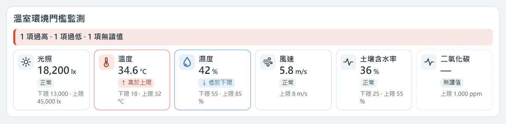

# 環境門檻監測卡

Home Assistant Lovelace 自訂卡片：監測現有的 `sensor.*` 實體，上下限可手動輸入或取自其他數值實體。不會觸發服務、不輪詢、不修改捲揚自動化。



## 透過 Home Assistant Marketplace 安裝（2026.11 起）

[](https://my.home-assistant.io/redirect/marketplace_repository/?owner=ivanlee1007&repository=ha-environment-threshold-card&category=plugin)

1. 以管理員身分開啟上方連結；也可進入 HA **設定 → Marketplace → 從連結新增**，輸入 `ivanlee1007/ha-environment-threshold-card`。新增自訂儲存庫需要連結 GitHub 帳號；若系統詢問類型，選 **Dashboard**。
2. 在 Marketplace 選擇 **安裝**，確認版本並依畫面提示完成，再重新整理瀏覽器。若以 YAML 管理儀表板資源，請依安裝視窗提示新增資源。
3. 編輯儀表板，新增「環境門檻監測」卡片。在「卡片外觀」可直接修改卡片標題，預覽會即時更新；留空則顯示預設標題「環境門檻監測」。
4. 在「監測項目」新增或選取一個項目編輯，使用 Home Assistant 原生實體選擇器搜尋並選取「感測器實體」。每次只編輯一個項目；切換項目前，請先按「套用項目」保留修改。
5. 在「門檻設定」中，下限和上限各自選擇「不設定」、「手動數值」或「實體來源」，只顯示對應欄位。手動欄位留空或清除所選的門檻實體，也不會設定該側門檻。「取消」不會套用項目草稿，但不會撤銷已更新預覽的卡片標題。最後由 HA 儲存儀表板。

如尚未列在 Marketplace 預設目錄，請由連結新增，無須手動複製 JavaScript。手動安裝時，才需把 Release 的 `environment-threshold-card.js` 複製到 HA 的 `<config>/www/`，並將 `/local/environment-threshold-card.js` 註冊為 JavaScript 模組。

## 密集模式（選用）

在 **卡片外觀 → 密集模式** 啟用。預設仍是原本的卡片版面，切換不會刪除段落或變更門檻。每個段落都有標題、項目數與獨立的感測器網格；300 px 寬的卡片通常每列有四個短讀值，較長的讀值會讓項目加寬，必要時使用科學記號保留有效數字。

- 在卡片外觀新增、選擇、重新命名或移除段落。在各監測項目選擇「所屬段落」，按「套用項目」確認；「取消」會捨棄該項目草稿，不會撤銷已預覽的卡片或段落修改。移除段落只把項目移到「未分組」，不刪除項目或門檻。最後由 HA 儲存儀表板。
- 點選感測器（鍵盤可用 Enter 或空白鍵）開關門檻詳情。過高為淡紅、過低為淡藍；無讀值或門檻異常為灰色虛線。「只看異常」暫時隱藏正常及未設門檻的項目，不變更設定；摘要仍統計全部項目。

YAML 使用 `display_mode: dense`、`sections` 及可選的 `items[].section`。段落 `id` 是唯一非空字串，`title` 可以重複，留空顯示「未命名段落」。將項目的 `section` 指向段落 `id`；省略或指向不存在的段落時，項目仍出現在「未分組」。舊有平面 `items` 不需遷移；門檻仍只在 `items` 設定。

```yaml
type: custom:environment-threshold-card
title: 即時環境門檻
display_mode: dense
sections:
  - id: outdoor
    title: 室外
  - id: seedlings
    title: 育苗區
items:
  - entity: sensor.roof_wind_speed
    section: outdoor
    above: 8
    unit: 'm/s'
  - entity: sensor.north_temperature
    section: seedlings
    below: 18
    unit: '°C'
```

## 卡片 YAML 範例

也可在手動卡片設定加入：

```yaml
type: custom:environment-threshold-card
title: 北側溫室
items:
  - entity: sensor.north_temperature
    kind: temperature
    below: 18
    above: input_number.greenhouse_high
    unit: '°C'
  - entity: sensor.roof_wind_speed
    kind: wind
    above: 8
    unit: 'm/s'
  - entity: sensor.north_humidity
    kind: humidity
    below: number.humidity_low
    above: sensor.humidity_high_setpoint
    unit: '%'
```

`below`／`above` 各自接受有限數字、`sensor`／`input_number`／`number`／`counter` 的實體 ID，或省略。舊版的數字門檻不需遷移。請替換範例的實體 ID 和門檻；不要把範例當成控制設備的安全設定。

## 顯示規則

- 不要求湊滿四項。每列依**卡片本身**寬度與已設定的項目數決定，空間不足會換行，空間足夠可超過四項；若 HA 的儀表板欄位配置限制卡片外框寬度，內部也會依實際空間排列。
- `kind` 可用 `light`、`temperature`、`humidity`、`wind`、`custom`；省略則以實體 device class 推斷。可重複使用相同類型或實體。
- 只在嚴格大於 `above` 或小於 `below` 時超標；可只設一邊，兩邊皆空只顯示讀值。若即時上下限相等或下限高於上限，暫停該項比較。
- 原本版面中，過高為紅色與向上動畫；過低為藍色與向下動畫。箭頭不是讀值趨勢。支援系統減少動態效果偏好。
- 門檻實體隨 HA 即時更新，不用等監測值變動。儀表板只顯示簡明門檻（如 `20–25 °C`、`上限 80%`、`上限 18 km/h`）；到該項目的「門檻設定」可查看來源 ID、原始讀值與換算結果。來源遺失、無讀值、非數字或單位不符時，卡片會簡述原因並暫停該項比較，不把問題當成 `0` 或「正常」。設定中不存在的實體 ID 會保留，待實體恢復後重新比較。
- 單位比對忽略前後空白。相對濕度（`humidity`）接受 `%`、`%H`、`%RH`；風速或速度（`wind_speed`／`speed`）的門檻實體支援 `m/s` ↔ `km/h` 雙向換算並顯示換算後數值。不相容或未支援的單位仍告警，不猜測單位。
- 無單位的 `input_number`、`number`、`counter` 門檻依監測感測器的單位解讀；無單位的 `sensor` 門檻則只能用於同樣無單位的感測器。
- 監測感測器遺失、`unknown`、`unavailable` 或非數字，顯示「無讀值」。圖形編輯器儲存門檻時會記錄感測器單位（無單位則記錄空字串）。感測器尚未出現時，可先儲存不含門檻的項目，或沿用同一實體已記錄的單位。若單位改變，會顯示「單位已變更」並暫停該項比較；請確認門檻適用於新單位後再儲存。手寫 YAML 若省略 `unit`，則沿用感測器目前回報的單位，不會固定原單位。
- 只在瀏覽器內顯示狀態；關閉儀表板後若需要通知或聯動，請另外用 HA 自動化實作。

## 開發測試

需要 Node.js 22 或更新版本。

```sh
npm ci --ignore-scripts
npx playwright install chromium
npm run check
npm test
```

Playwright 使用模擬 HA 實體資料及原生選擇器的事件介面，測試卡片及編輯器寬度、深淺主題、即時門檻、標題預覽與設定回傳時的草稿和焦點，不連線到 HA。原生選擇器的搜尋與鍵盤互動需另在 HA 前端驗證。
